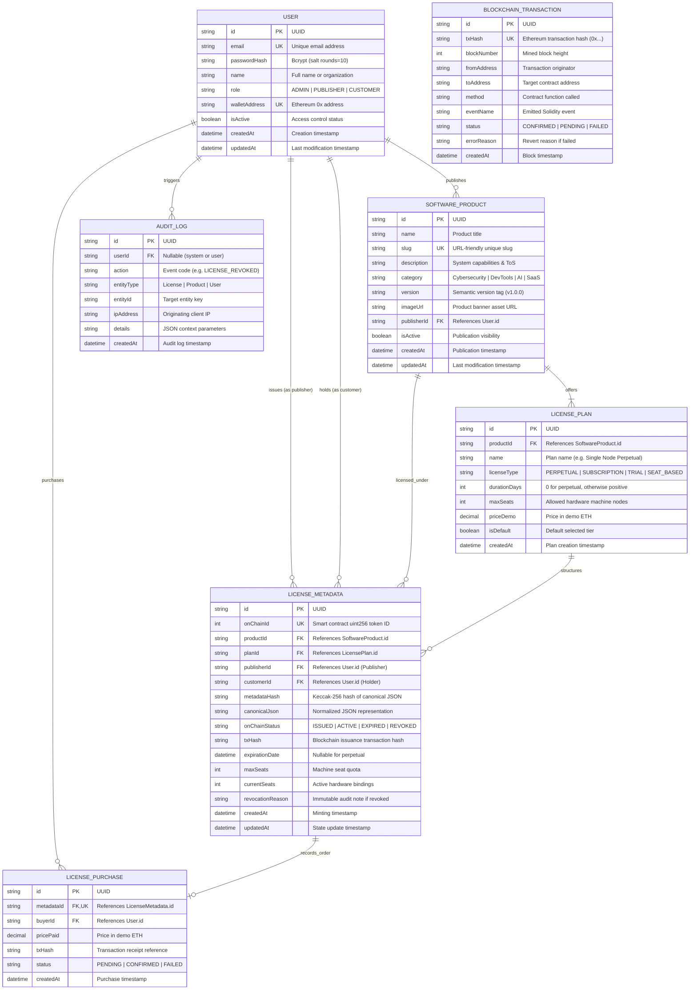

# Database Entity-Relationship (ER) Diagram

This document models the relational schema implemented via **Prisma ORM** for the **ChainLicense Platform**.

---

## 1. Mermaid Entity-Relationship Model

---

## 2. Table Indexing & Performance Strategy
- **`User`**: Indexed on `email`, `walletAddress`, and `role` for high-throughput authentication queries.
- **`SoftwareProduct`**: Indexed on `slug` for clean URL resolution and `publisherId` for vendor dashboard aggregation.
- **`LicenseMetadata`**: Indexed on `onChainId` for sub-millisecond lookup during verification, and `metadataHash` for integrity checks.
- **`BlockchainTransaction`**: Indexed on `txHash` to eliminate duplicate transaction records.
