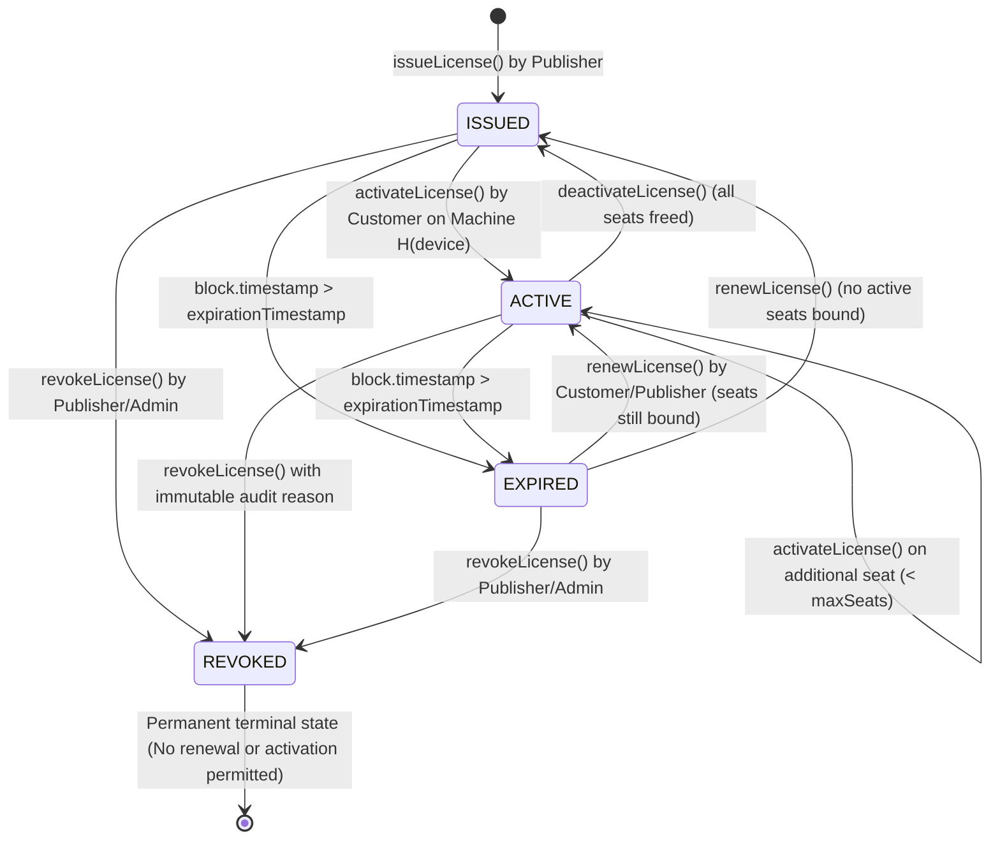

# License Lifecycle State Machine & Flowchart

This document details the on-chain finite-state machine governing software licenses in **`SoftwareLicenseManager.sol`**.

---

## 1. Lifecycle State Machine Diagram

---

## 2. State Invariants & Transition Rules

### 1. `ISSUED` (State Code 0)
- **Initial State**: A license is minted on-chain with a unique token ID (`nextLicenseId`), assigned to a customer wallet.
- **Seat Occupancy**: `currentActivations = 0`.
- **Allowed Actions**:
  - `activateLicense(licenseId, deviceFingerprint)` $\to$ Transitions to `ACTIVE`.
  - `revokeLicense(licenseId, reason)` $\to$ Transitions to `REVOKED`.

### 2. `ACTIVE` (State Code 1)
- **Functional State**: At least one hardware device fingerprint is authorized and recorded in `_boundDevices`.
- **Seat Occupancy**: $1 \le \text{currentActivations} \le \text{maxActivations}$.
- **Public Verification**: Returns `isValid = true`, `statusMessage = "VALID: Verified authentic on-chain"`.
- **Allowed Actions**:
  - `activateLicense(device2)` $\to$ Binds another machine if $\text{currentActivations} < \text{maxActivations}$.
  - `deactivateLicense(device1)` $\to$ Frees up a seat. If `currentActivations` drops to 0, transitions to `ISSUED`.
  - `revokeLicense(reason)` $\to$ Transitions to `REVOKED`.

### 3. `EXPIRED` (State Code 2)
- **Time-Bound State**: Triggered dynamically when `block.timestamp > expirationTimestamp` on non-perpetual subscription licenses.
- **Public Verification**: Returns `isValid = false`, `statusMessage = "EXPIRED: License validity period elapsed"`.
- **Allowed Actions**:
  - `renewLicense(additionalSeconds)` $\to$ Extends expiration timestamp and re-activates the license.
  - `revokeLicense(reason)` $\to$ Transitions to `REVOKED`.
  - `activateLicense()` $\to$ **REVERTED**: Cannot activate an expired license.

### 4. `REVOKED` (State Code 3)
- **Terminal State**: Triggered by the issuing publisher or system administrator upon detecting fraud, piracy key dumps, or chargebacks.
- **Immutability Invariant**:
  - Revoked licenses **cannot be renewed**.
  - Revoked licenses **cannot be activated**.
  - Public verification **always returns `isValid = false`** and outputs the recorded reason.
